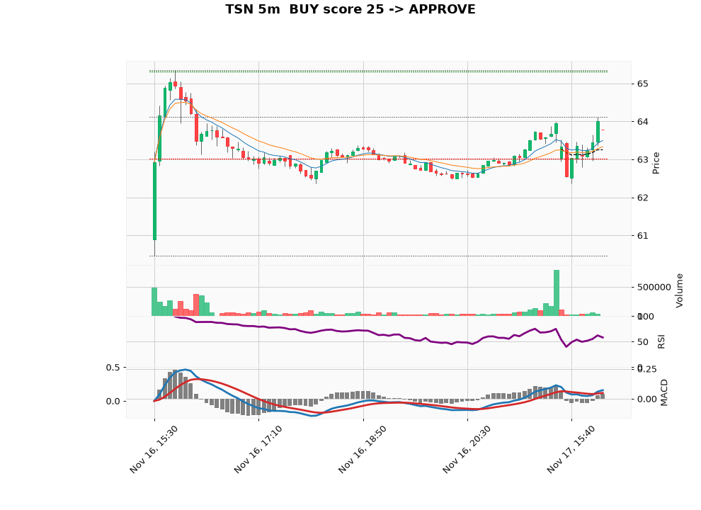
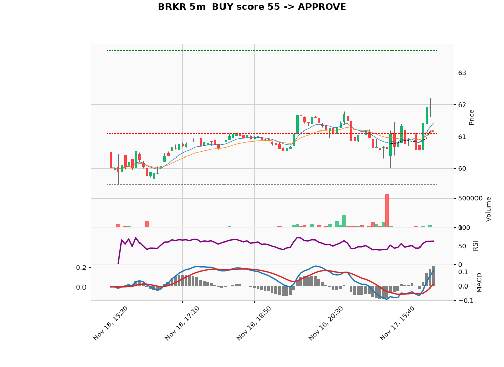
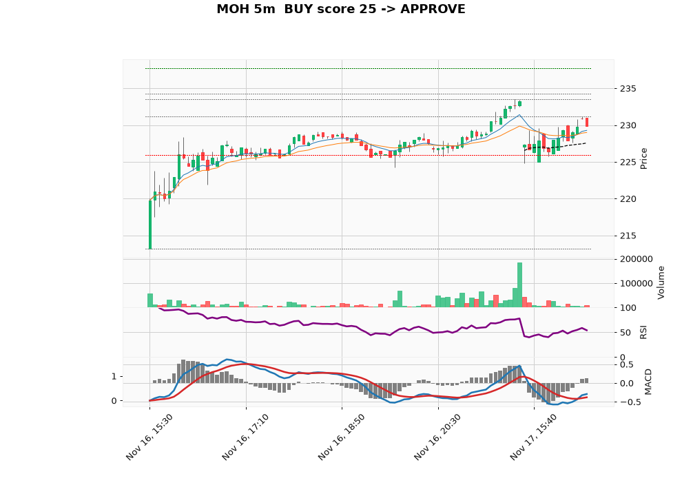
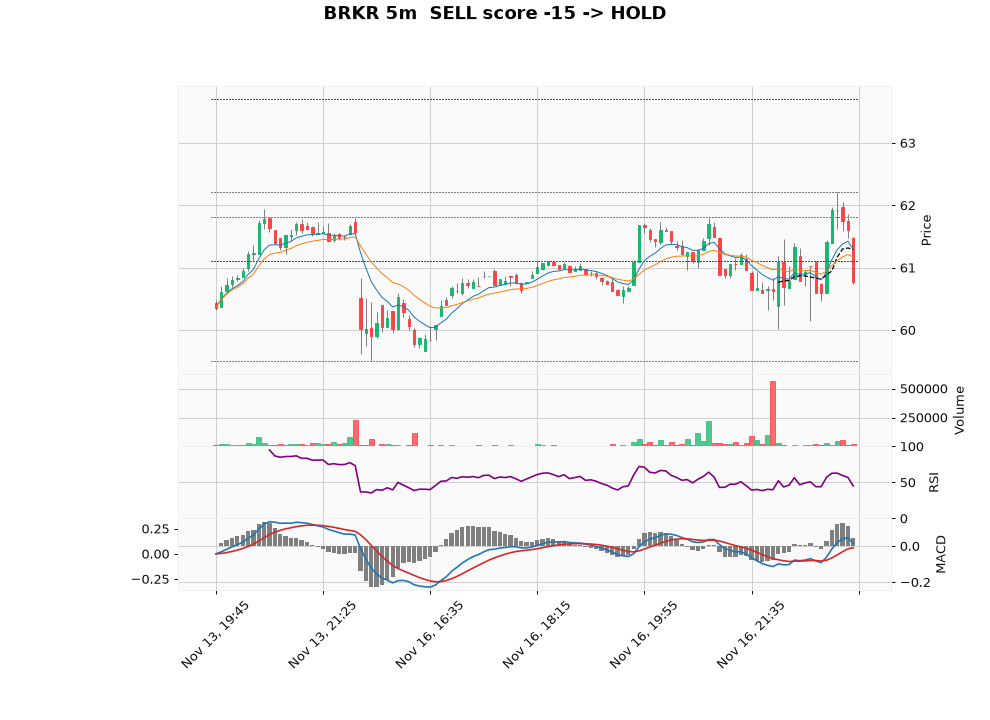
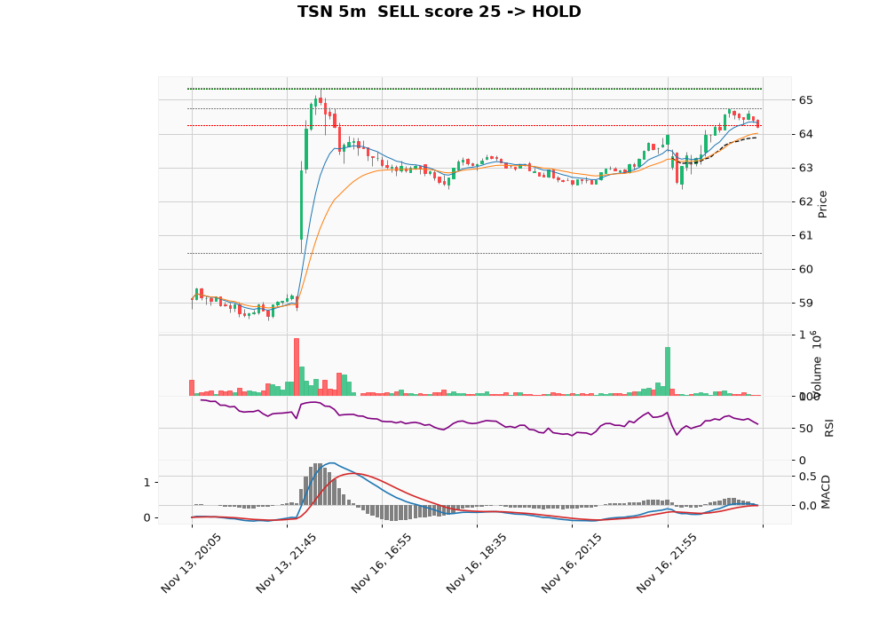
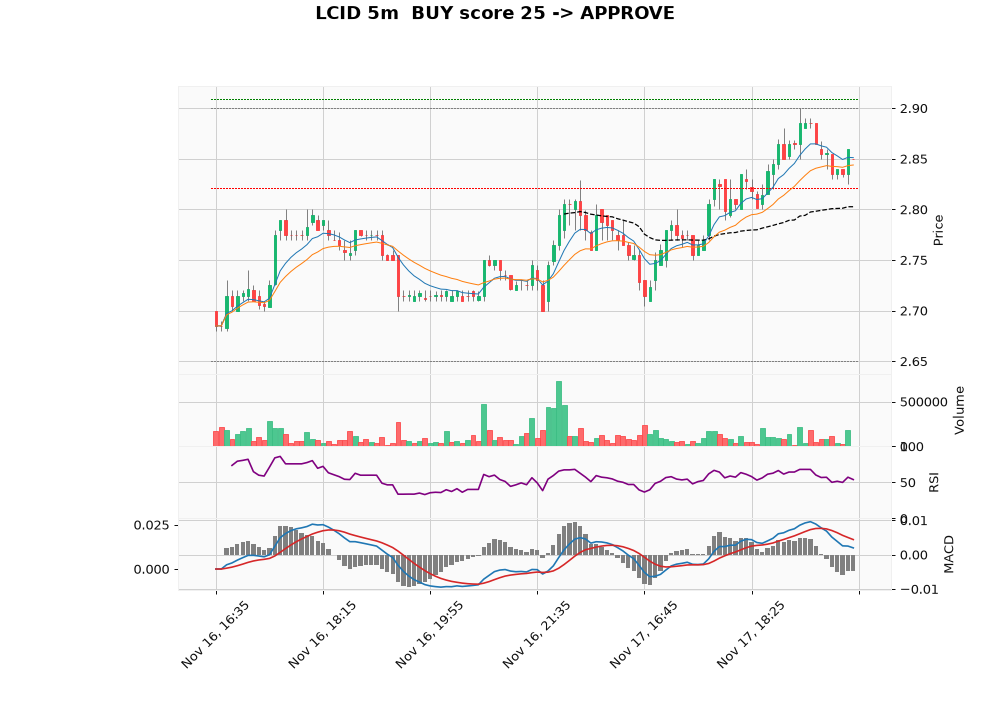
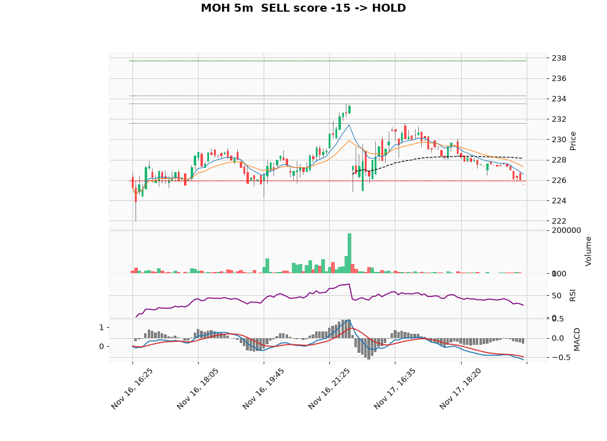
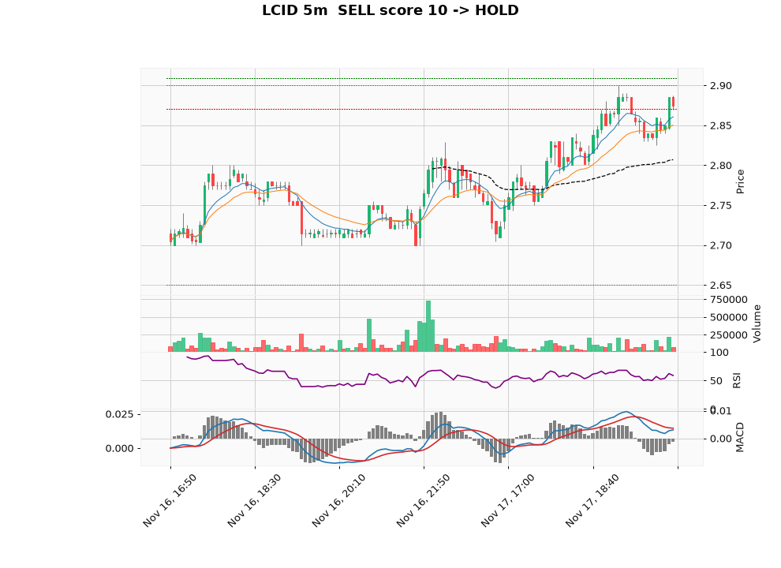

# Report giornaliero paper trading – 17/11/2026
_Generato alle 21:55 ora di Roma. Soldi finti: nessun broker reale coinvolto._

## Conto
- Equity: **984,23 €** (inizio giornata 1.000,00 €)
- P&L di oggi (netto commissioni e tasse realizzate): **-15,77 € (-1,58%)**
- P&L cumulato dall'avvio (1.000,00 €): **-15,77 € (-1,58%)**

## Risultato realizzato oggi
- P&L lordo: -7,77 €
- Commissioni pagate: 8,00 € (8 ordini × 1 €)
- Imposta 26% trattenuta: 0,00 €
- P&L netto dopo tasse: **-15,77 €**
- Zainetto fiscale (minusvalenze compensabili, scadenza 4 anni): 15,77 €
- Operazioni chiuse: 4, vincenti 0 → win rate 0%
- Win rate storico: 0% su 4 operazioni

## Operazioni di oggi
| Ora | Titolo | Lato | Qtà | Prezzo | Valore | Comm. | Netto | Motivo |
|---|---|---|---|---|---|---|---|---|
| 16:10 | Tyson Foods (TSN) | ACQUISTO | 5.1692 | 63.817 USD | 299,99 € | 1,00 € |  | ORB long: prezzo 63.785, ORH 63.531, ORL 62.370, VWAP 63.253, ATR5m 0.511, EMA9 63.497, EM |
| 16:31 | Bruker (BRKR) | ACQUISTO | 5.3372 | 62.001 USD | 300,86 € | 1,00 € |  | ORB long: prezzo 61.970, ORH 61.460, ORL 60.025, VWAP 61.169, ATR5m 0.576, EMA9 61.425, EM |
| 16:41 | Molina Healthcare (MOH) | ACQUISTO | 1.4346 | 229.965 USD | 299,82 € | 1,00 € |  | ORB long: prezzo 229.850, ORH 229.560, ORL 224.834, VWAP 227.570, ATR5m 2.612, EMA9 229.28 |
| 16:44 | Bruker (BRKR) | VENDITA | 5.3372 | 61.049 USD | 295,89 € | 1,00 € | -6,98 € | stop 61.1067 colpito alle 16:43 |
| 17:04 | Tyson Foods (TSN) | VENDITA | 5.1692 | 64.211 USD | 301,51 € | 1,00 € | -0,48 € | stop 64.2430 colpito alle 17:00 |
| 20:00 | LCID (LCID) | ACQUISTO | 114.2830 | 2.852 USD | 295,83 € | 1,00 € |  | ORB long: prezzo 2.850, ORH 2.829, ORL 2.760, VWAP 2.803, ATR5m 0.020, EMA9 2.851, EMA21 2 |
| 20:02 | Molina Healthcare (MOH) | VENDITA | 1.4346 | 225.457 USD | 293,62 € | 1,00 € | -8,20 € | stop 225.9314 colpito alle 20:00 |
| 20:18 | LCID (LCID) | VENDITA | 114.2830 | 2.869 USD | 297,72 € | 1,00 € | -0,12 € | stop 2.8708 colpito alle 20:15 |

## Confronto con benchmark
- EXS1.DE (ETF DAX) dall'apertura: -1,15% (netto 2 € di commissioni su 1.000,00 €: -1,35%)
- Team: -1,58% → peggio del semplice acquisto del benchmark di -0,23%

## Cosa ha funzionato / cosa no
- Migliore: LCID -0,12 € (stop loss); peggiore: Molina Healthcare -8,20 € (stop loss)
- Uscite: stop loss 4
- Peso delle commissioni: 103% del P&L lordo
- Analista grafico: 19 segnali valutati, 4 approvati, 15 rifiutati
- Motivi principali per cui non si è entrati (controlli titolo×passaggio): nessun breakout (1323); momentum Nm negativo (1179); troppo esteso, non inseguo (880); filtro commissioni (guadagno atteso sotto 6 €) (669); quotazione vecchia (595)
- Filtro commissioni: 669 scarti su 254 titoli (RTX 10, FCN 8, PM 8, WSO 8, NYT 8, SLAB 8, HGV 7, KR 7)
- Clima notizie macro (12h): -0.00 su 291 titoli

## Grafici delle operazioni

