# Report giornaliero paper trading – 18/11/2026
_Generato alle 21:55 ora di Roma. Soldi finti: nessun broker reale coinvolto._

## Conto
- Equity: **963,89 €** (inizio giornata 984,23 €)
- P&L di oggi (netto commissioni e tasse realizzate): **-20,34 € (-2,07%)**
- P&L cumulato dall'avvio (1.000,00 €): **-36,11 € (-3,61%)**

## Risultato realizzato oggi
- P&L lordo: -8,34 €
- Commissioni pagate: 12,00 € (12 ordini × 1 €)
- Imposta 26% trattenuta: 0,00 €
- P&L netto dopo tasse: **-20,34 €**
- Zainetto fiscale (minusvalenze compensabili, scadenza 4 anni): 36,11 €
- Operazioni chiuse: 6, vincenti 1 → win rate 17%
- Win rate storico: 10% su 10 operazioni

## Operazioni di oggi
| Ora | Titolo | Lato | Qtà | Prezzo | Valore | Comm. | Netto | Motivo |
|---|---|---|---|---|---|---|---|---|
| 16:10 | CommVault Systems (CVLT) | ACQUISTO | 2.2056 | 146.963 USD | 295,26 € | 1,00 € |  | ORB long: prezzo 146.890, ORH 145.170, ORL 141.595, VWAP 144.645, ATR5m 1.165, EMA9 144.93 |
| 16:10 | Ollie's Bargain Outlet (OLLI) | ACQUISTO | 3.3355 | 97.069 USD | 294,92 € | 1,00 € |  | ORB long: prezzo 97.020, ORH 96.410, ORL 93.000, VWAP 95.771, ATR5m 0.689, EMA9 95.875, EM |
| 16:10 | Celsius Holdings (CELH) | ACQUISTO | 9.8023 | 32.991 USD | 294,58 € | 1,00 € |  | ORB long: prezzo 32.975, ORH 32.940, ORL 31.800, VWAP 32.548, ATR5m 0.384, EMA9 32.554, EM |
| 16:28 | Ollie's Bargain Outlet (OLLI) | VENDITA | 3.3355 | 97.516 USD | 296,51 € | 1,00 € | -0,41 € | stop 97.7263 colpito alle 16:20 |
| 16:28 | Celsius Holdings (CELH) | VENDITA | 9.8023 | 32.382 USD | 289,36 € | 1,00 € | -7,22 € | stop 32.3986 colpito alle 16:25 |
| 16:30 | Planet Fitness (PLNT) | ACQUISTO | 5.1024 | 62.991 USD | 292,96 € | 1,00 € |  | ORB long: prezzo 62.960, ORH 62.350, ORL 60.960, VWAP 62.196, ATR5m 0.438, EMA9 62.476, EM |
| 16:31 | Brinker International (EAT) | ACQUISTO | 1.5719 | 204.232 USD | 292,62 € | 1,00 € |  | ORB long: prezzo 204.130, ORH 201.330, ORL 193.560, VWAP 200.207, ATR5m 2.017, EMA9 201.71 |
| 17:22 | Planet Fitness (PLNT) | VENDITA | 5.1024 | 62.271 USD | 289,77 € | 1,00 € | -5,19 € | stop 62.3025 colpito alle 17:20 |
| 17:50 | CommVault Systems (CVLT) | VENDITA | 2.2056 | 147.884 USD | 297,41 € | 1,00 € | 0,14 € | stop 147.9583 colpito alle 17:45 |
| 17:54 | Brinker International (EAT) | VENDITA | 1.5719 | 201.005 USD | 288,03 € | 1,00 € | -6,59 € | stop 201.1051 colpito alle 17:50 |
| 20:50 | Wingstop (WING) | ACQUISTO | 2.0307 | 156.328 USD | 289,49 € | 1,00 € |  | ORB long: prezzo 156.250, ORH 153.960, ORL 146.020, VWAP 149.219, ATR5m 1.562, EMA9 153.16 |
| 21:50 | Wingstop (WING) | VENDITA | 2.0307 | 157.001 USD | 290,42 € | 1,00 € | -1,07 € | chiusura fine giornata |

## Confronto con benchmark
- EXS1.DE (ETF DAX) dall'apertura: -1,23% (netto 2 € di commissioni su 984,23 €: -1,44%)
- Team: -2,07% → peggio del semplice acquisto del benchmark di -0,63%

## Cosa ha funzionato / cosa no
- Migliore: CommVault Systems 0,14 € (stop loss); peggiore: Celsius Holdings -7,22 € (stop loss)
- Uscite: stop loss 5, chiusura fine giornata 1
- Peso delle commissioni: 144% del P&L lordo
- Analista grafico: 33 segnali valutati, 6 approvati, 27 rifiutati
- Motivi principali per cui non si è entrati (controlli titolo×passaggio): momentum Nm negativo (3555); troppo esteso, non inseguo (3419); max N posizioni aperte (1856); nessun breakout (1472); fuori finestra ingressi (1294); filtro commissioni (guadagno atteso sotto 6 €) (1255)
- Filtro commissioni: 1255 scarti su 507 titoli (BFIT.AS 10, ENR.DE 9, OMC 9, PUB.PA 7, SZG.DE 7, SR 7, CAH 7, CPAY 7)
- Clima notizie macro (12h): +0.05 su 273 titoli

## Grafici delle operazioni
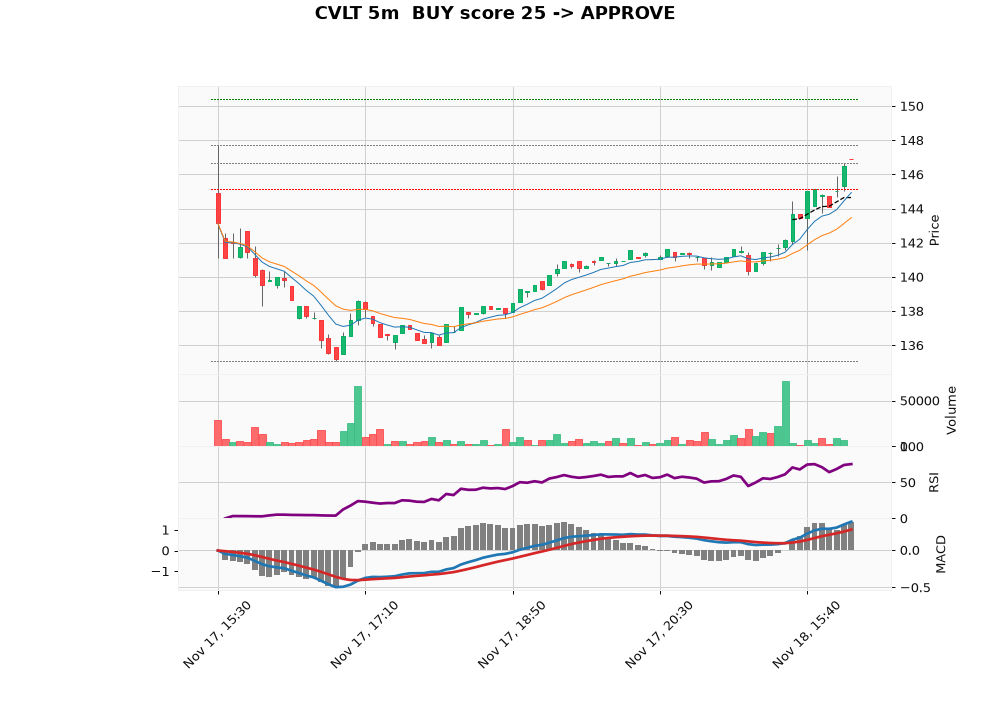
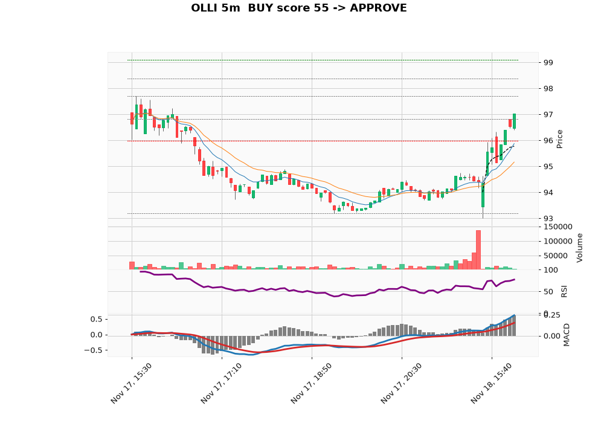
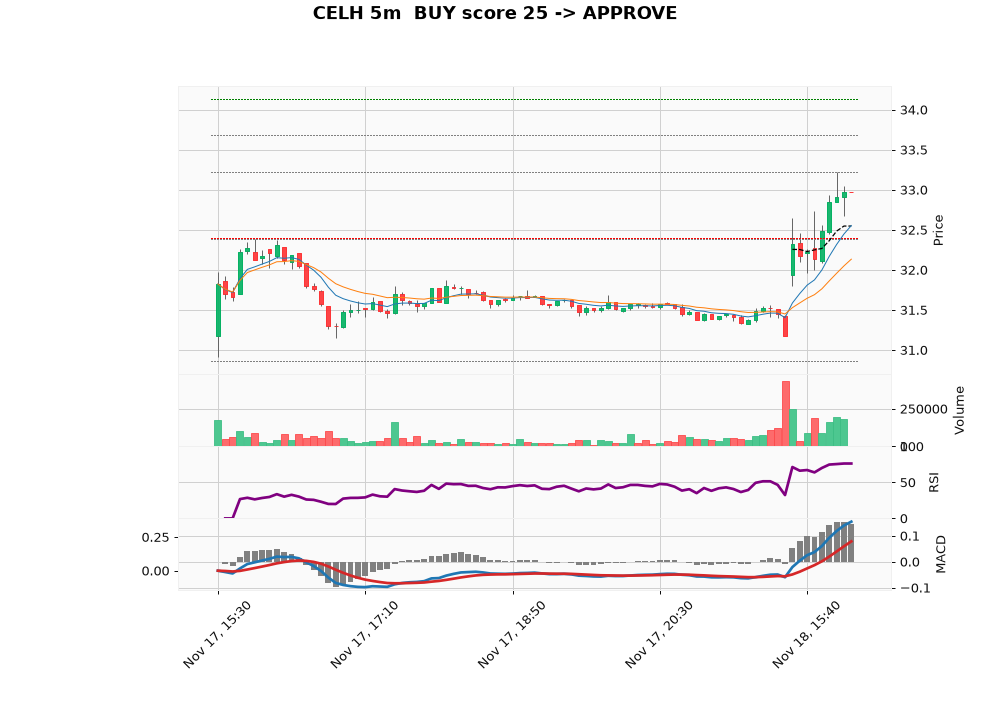
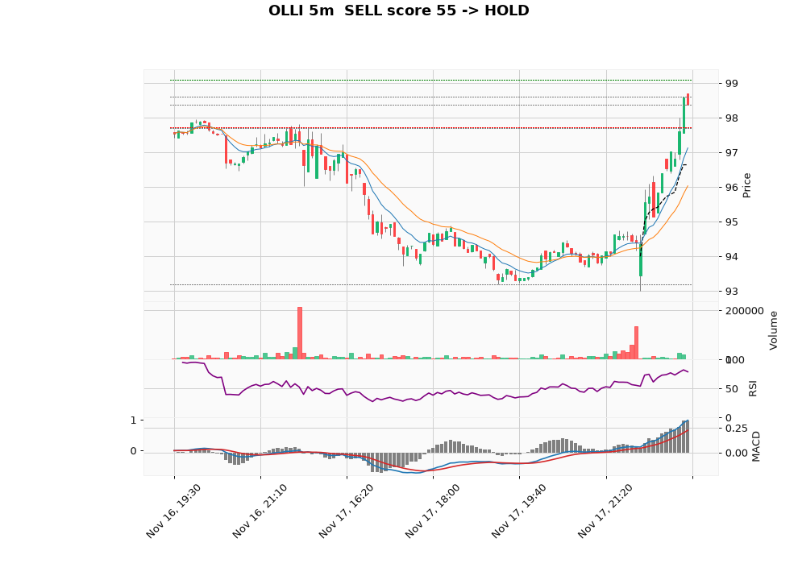
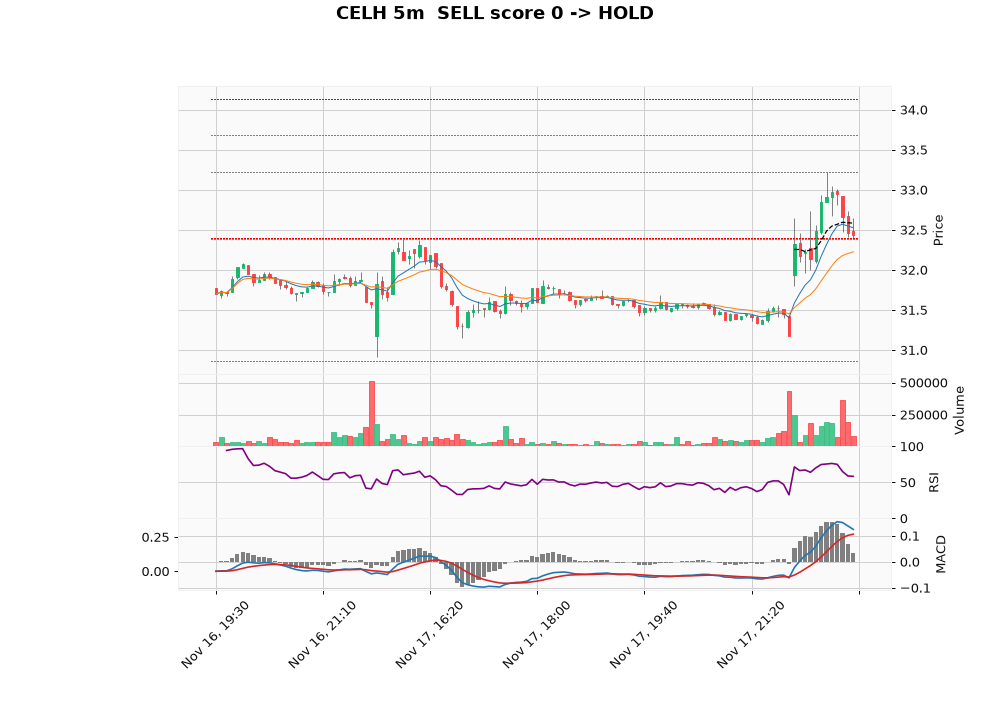
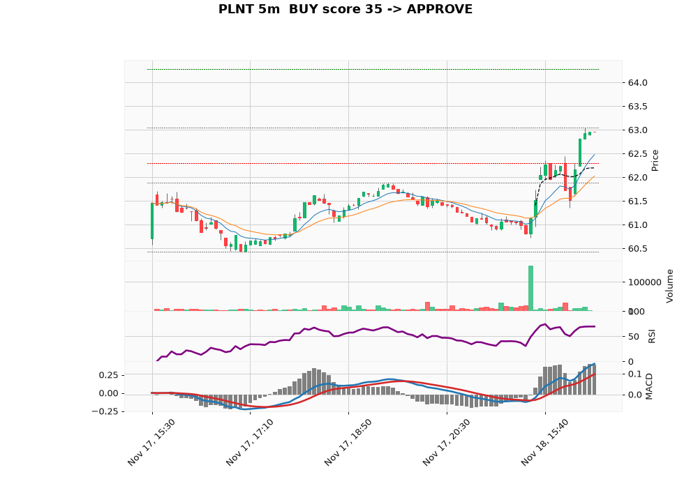
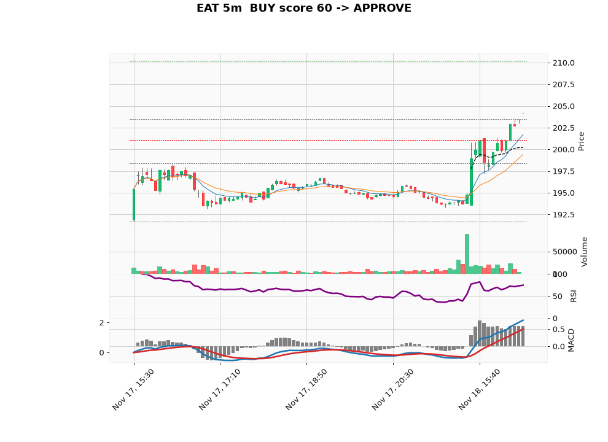
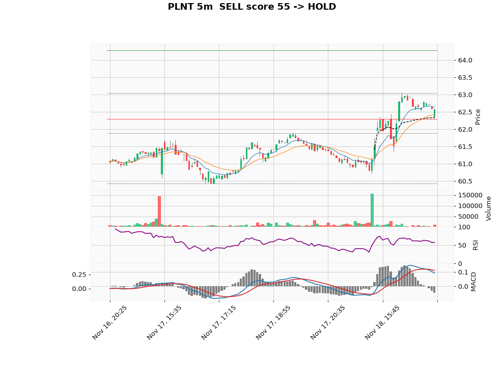
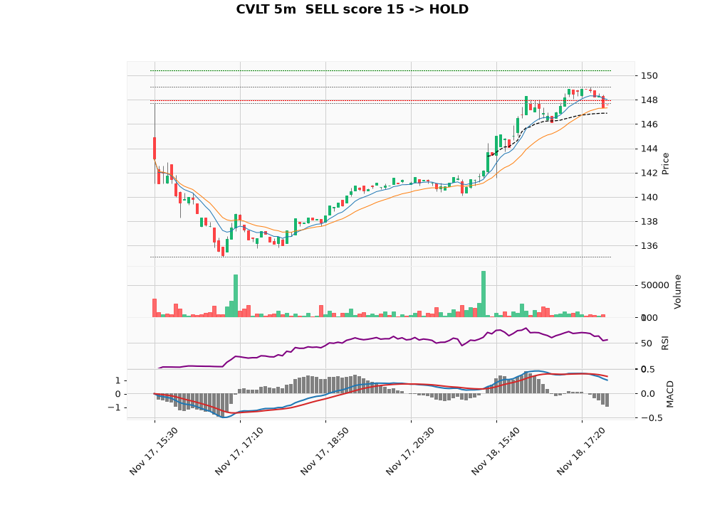
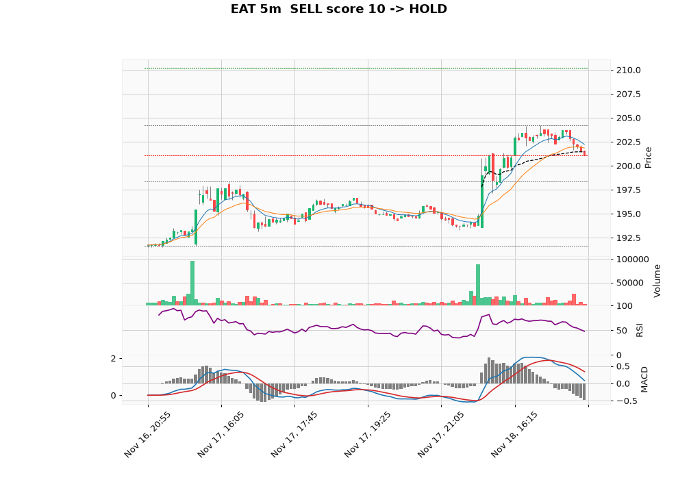
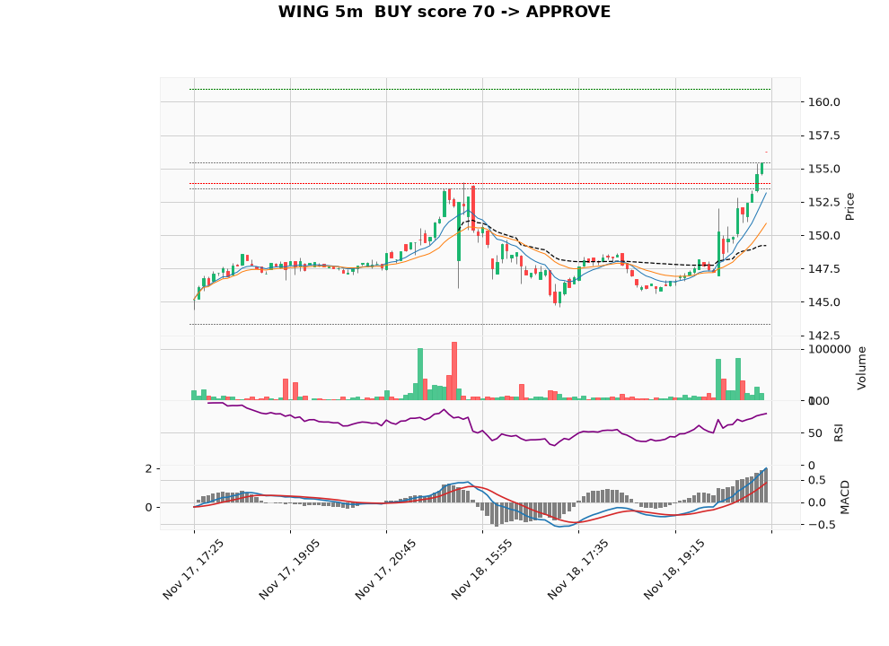
