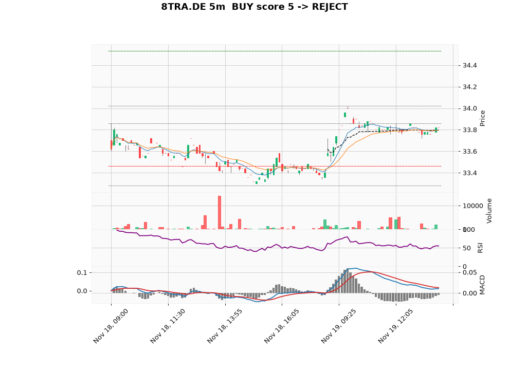
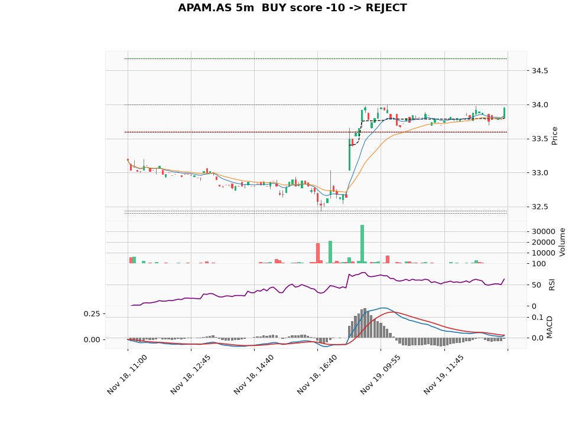
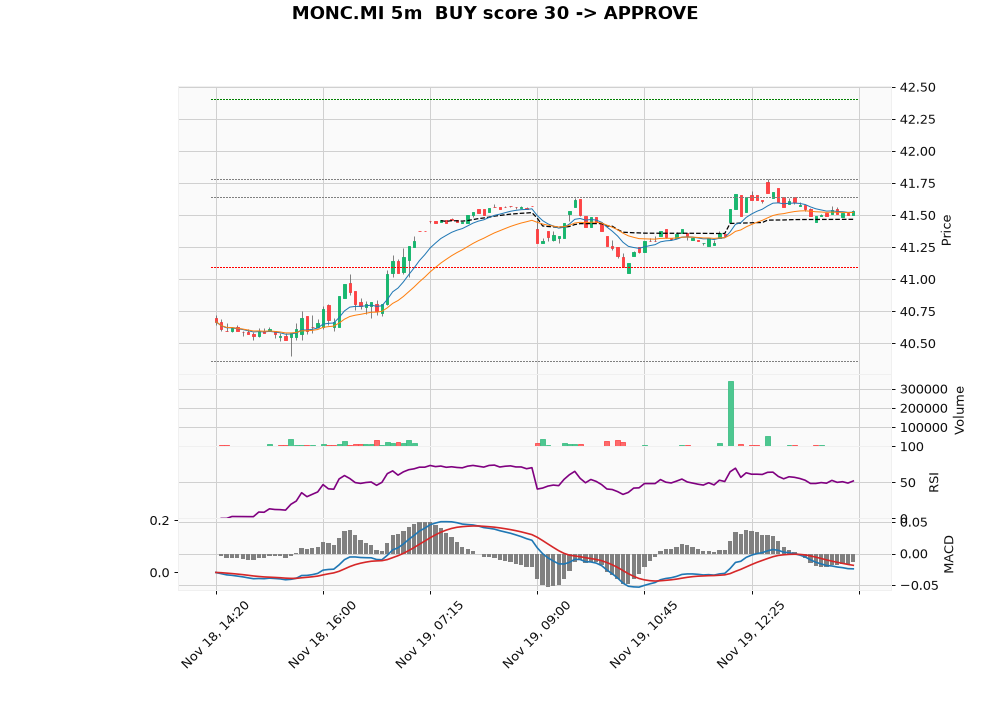
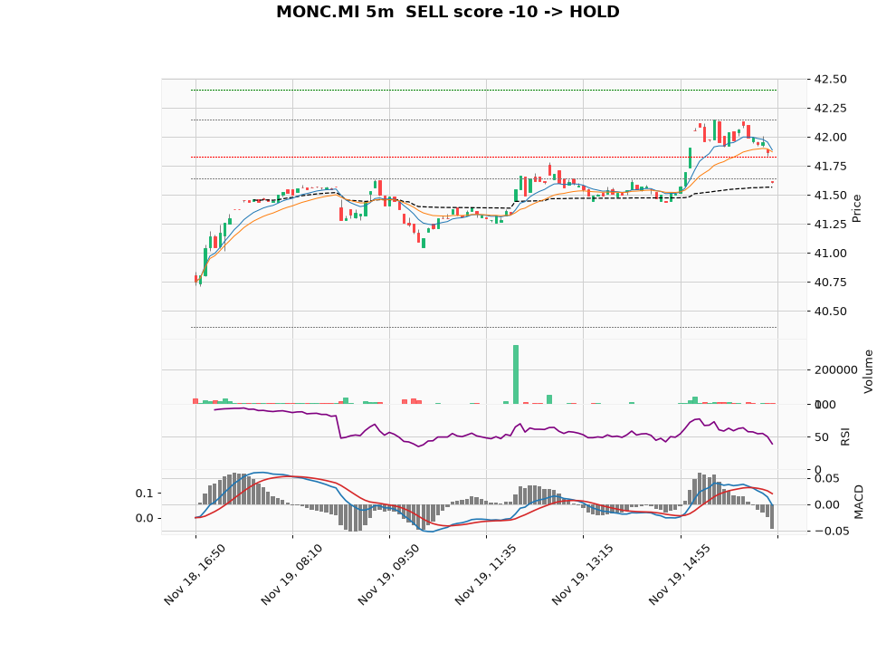
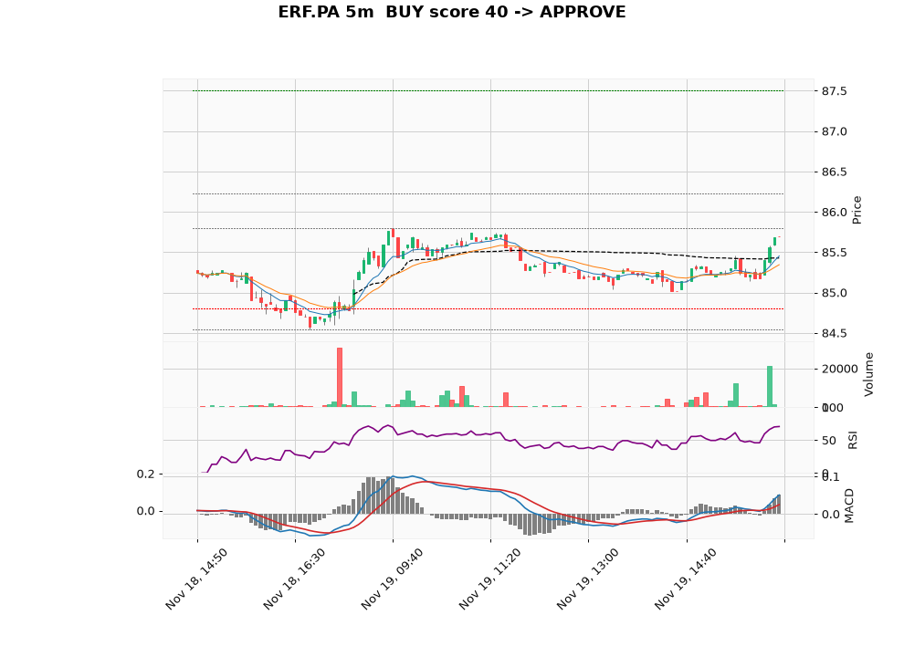
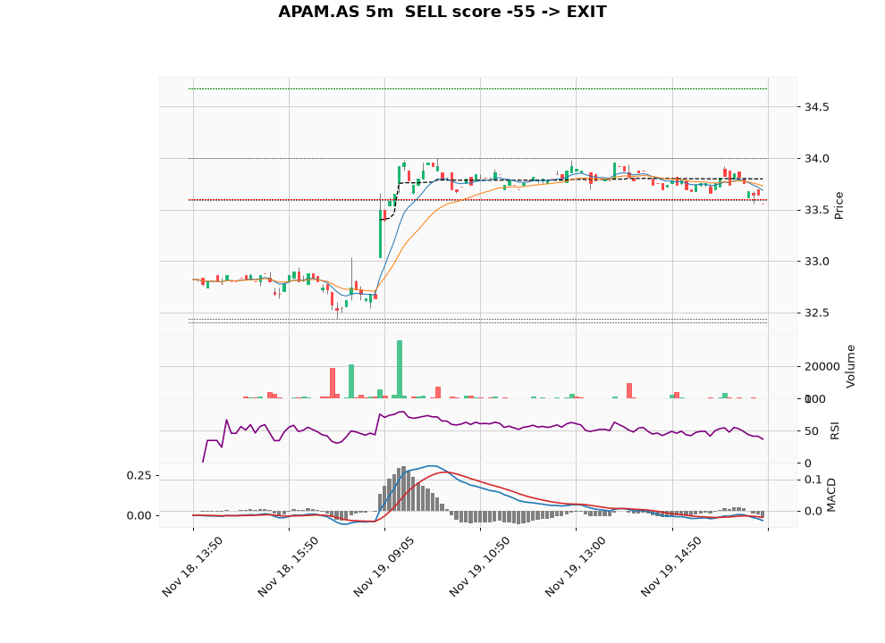
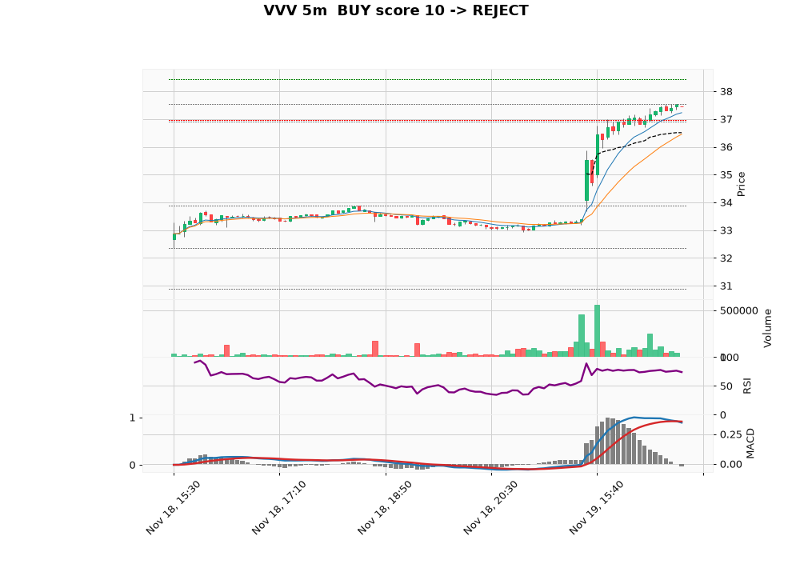
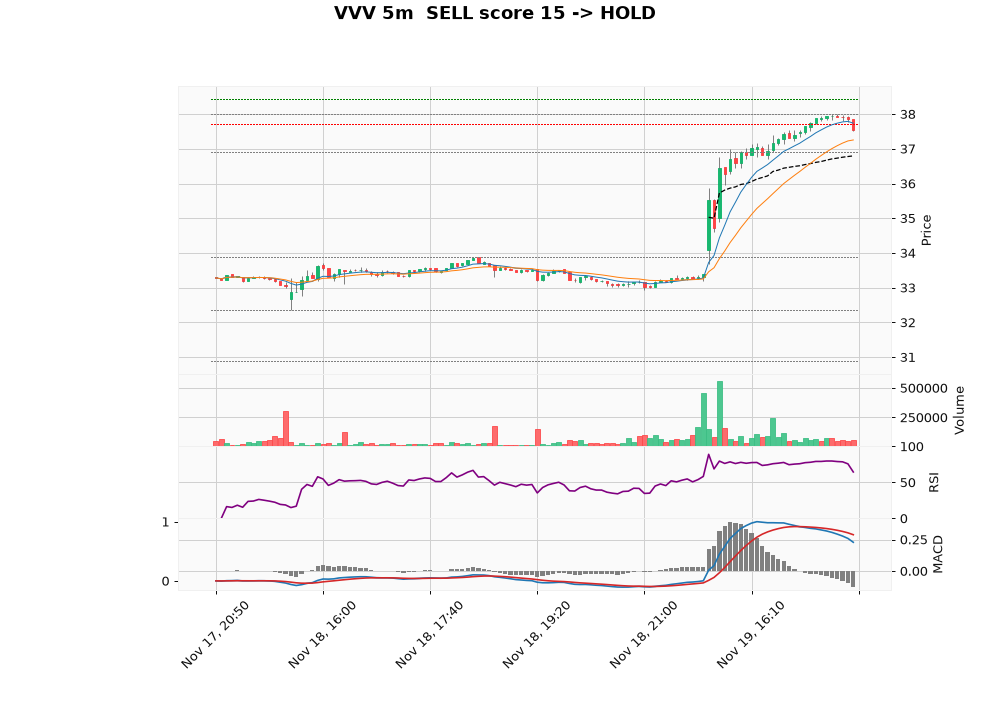
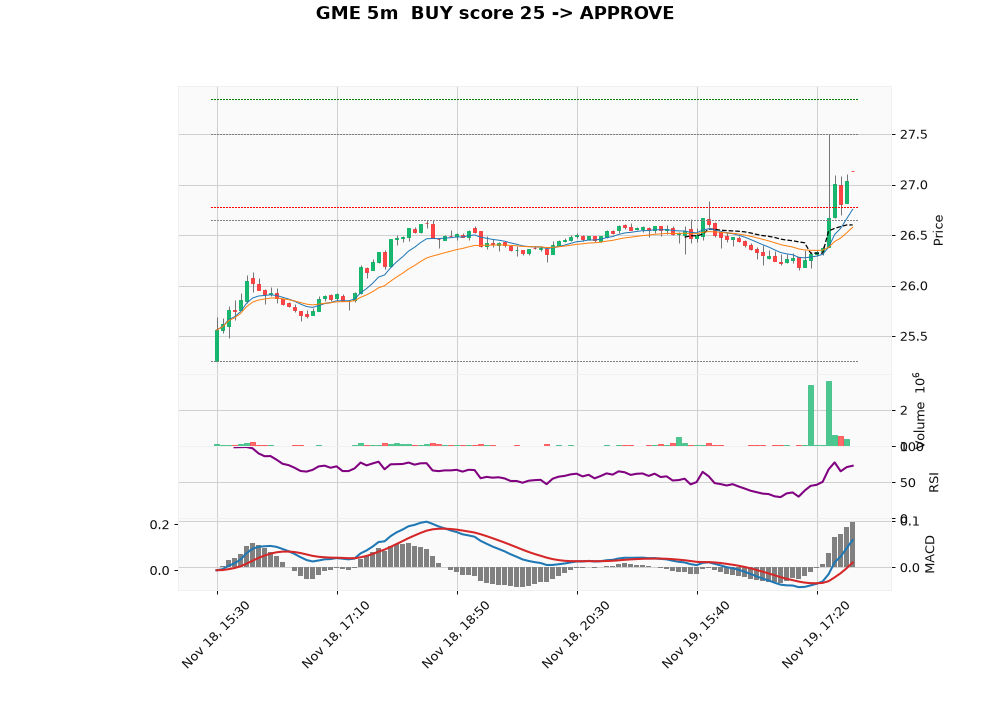
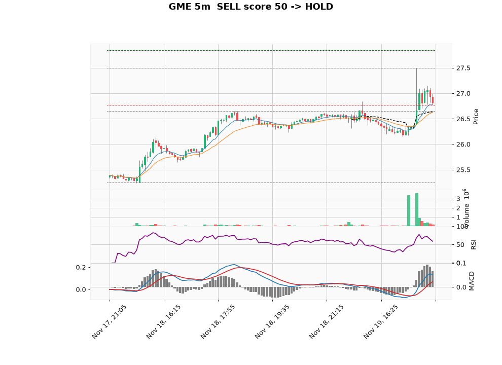

# Report giornaliero paper trading – 19/11/2026
_Generato alle 21:55 ora di Roma. Soldi finti: nessun broker reale coinvolto._

## Conto
- Equity: **943,56 €** (inizio giornata 963,89 €)
- P&L di oggi (netto commissioni e tasse realizzate): **-20,33 € (-2,11%)**
- P&L cumulato dall'avvio (1.000,00 €): **-56,44 € (-5,64%)**

## Risultato realizzato oggi
- P&L lordo: -8,33 €
- Commissioni pagate: 12,00 € (12 ordini × 1 €)
- Imposta 26% trattenuta: 0,00 €
- P&L netto dopo tasse: **-20,33 €**
- Zainetto fiscale (minusvalenze compensabili, scadenza 4 anni): 56,44 €
- Operazioni chiuse: 6, vincenti 0 → win rate 0%
- Win rate storico: 6% su 16 operazioni

## Operazioni di oggi
| Ora | Titolo | Lato | Qtà | Prezzo | Valore | Comm. | Netto | Motivo |
|---|---|---|---|---|---|---|---|---|
| 14:00 | Traton (8TRA.DE) | ACQUISTO | 8.5458 | 33.837 EUR | 289,16 € | 1,00 € |  | ORB long: prezzo 33.820, ORH 33.800, ORL 33.500, VWAP 33.794, ATR5m 0.030, EMA9 33.800, EM |
| 14:00 | Aperam (APAM.AS) | ACQUISTO | 8.5005 | 33.977 EUR | 288,82 € | 1,00 € |  | ORB long: prezzo 33.960, ORH 33.920, ORL 33.040, VWAP 33.794, ATR5m 0.074, EMA9 33.835, EM |
| 14:00 | Moncler (MONC.MI) | ACQUISTO | 6.9446 | 41.540 EUR | 288,48 € | 1,00 € |  | ORB long: prezzo 41.530, ORH 41.465, ORL 41.280, VWAP 41.468, ATR5m 0.048, EMA9 41.523, EM |
| 16:30 | Moncler (MONC.MI) | VENDITA | 6.9446 | 41.589 EUR | 288,82 € | 1,00 € | -1,66 € | stop 41.8280 colpito alle 16:30 |
| 16:30 | Eurofins Scientific (ERF.PA) | ACQUISTO | 3.3503 | 85.743 EUR | 287,26 € | 1,00 € |  | ORB long: prezzo 85.700, ORH 85.560, ORL 84.740, VWAP 85.428, ATR5m 0.107, EMA9 85.453, EM |
| 16:50 | Aperam (APAM.AS) | VENDITA | 8.5005 | 33.543 EUR | 285,13 € | 1,00 € | -5,69 € | stop 33.6034 colpito alle 16:30 |
| 17:00 | Valvoline (VVV) | ACQUISTO | 8.3792 | 37.464 USD | 285,79 € | 1,00 € |  | ORB long: prezzo 37.445, ORH 37.000, ORL 33.685, VWAP 36.510, ATR5m 0.325, EMA9 37.229, EM |
| 17:48 | Valvoline (VVV) | VENDITA | 8.3792 | 37.707 USD | 287,64 € | 1,00 € | -0,14 € | stop 37.7258 colpito alle 17:46 |
| 17:50 | GameStop (GME) | ACQUISTO | 11.5542 | 27.144 USD | 285,52 € | 1,00 € |  | ORB long: prezzo 27.130, ORH 26.840, ORL 26.310, VWAP 26.600, ATR5m 0.237, EMA9 26.755, EM |
| 18:04 | GameStop (GME) | VENDITA | 11.5542 | 26.761 USD | 281,62 € | 1,00 € | -5,90 € | stop 26.7741 colpito alle 18:02 |
| 21:50 | Traton (8TRA.DE) | VENDITA | 8.5458 | 33.503 EUR | 286,31 € | 1,00 € | -4,85 € | chiusura fine giornata |
| 21:50 | Eurofins Scientific (ERF.PA) | VENDITA | 3.3503 | 85.717 EUR | 287,18 € | 1,00 € | -2,09 € | chiusura fine giornata |

## Confronto con benchmark
- EXS1.DE (ETF DAX) dall'apertura: -1,41% (netto 2 € di commissioni su 963,89 €: -1,62%)
- Team: -2,11% → peggio del semplice acquisto del benchmark di -0,49%

## Cosa ha funzionato / cosa no
- Migliore: Valvoline -0,14 € (stop loss); peggiore: GameStop -5,90 € (stop loss)
- Uscite: stop loss 4, chiusura fine giornata 2
- Peso delle commissioni: 144% del P&L lordo
- Analista grafico: 13 segnali valutati, 3 approvati, 10 rifiutati
- Motivi principali per cui non si è entrati (controlli titolo×passaggio): max N posizioni aperte (1109); nessun breakout (679); momentum Nm negativo (564); troppo esteso, non inseguo (426); filtro commissioni (guadagno atteso sotto 6 €) (391)
- Filtro commissioni: 391 scarti su 152 titoli (SAN.MC 9, IP.MI 7, P911.DE 7, INGA.AS 6, FBIN 6, JD 6, NDA-FI.HE 5, MC.PA 5)
- Clima notizie macro (12h): +0.08 su 278 titoli

## Grafici delle operazioni

