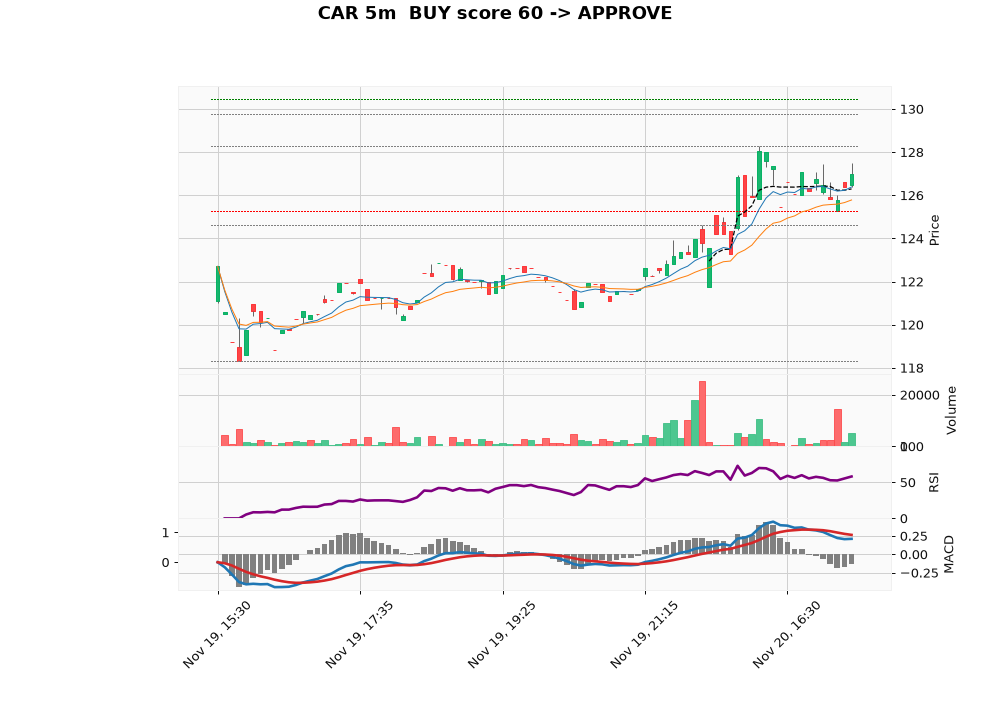
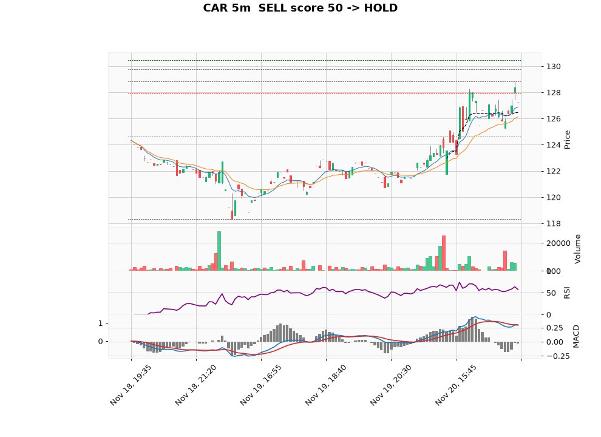
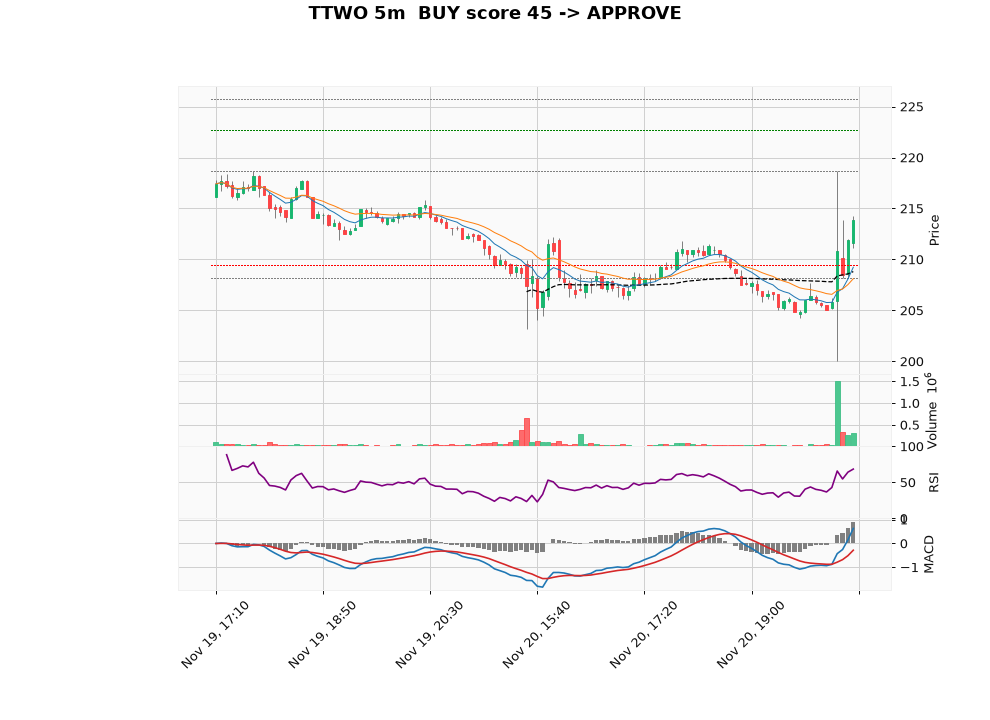
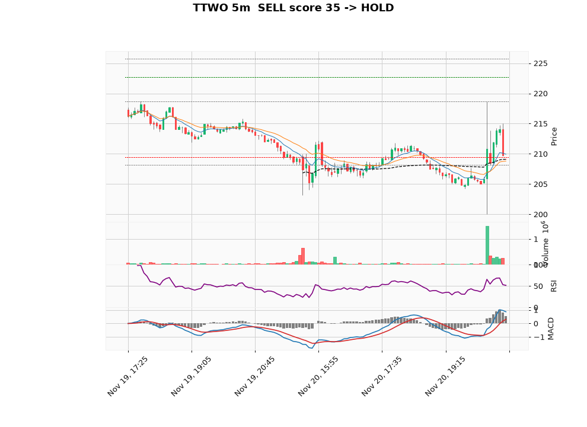

# Report giornaliero paper trading – 20/11/2026
_Generato alle 21:55 ora di Roma. Soldi finti: nessun broker reale coinvolto._

## Conto
- Equity: **933,54 €** (inizio giornata 943,56 €)
- P&L di oggi (netto commissioni e tasse realizzate): **-10,01 € (-1,06%)**
- P&L cumulato dall'avvio (1.000,00 €): **-66,46 € (-6,65%)**

## Risultato realizzato oggi
- P&L lordo: -6,01 €
- Commissioni pagate: 4,00 € (4 ordini × 1 €)
- Imposta 26% trattenuta: 0,00 €
- P&L netto dopo tasse: **-10,01 €**
- Zainetto fiscale (minusvalenze compensabili, scadenza 4 anni): 66,46 €
- Operazioni chiuse: 2, vincenti 0 → win rate 0%
- Win rate storico: 6% su 18 operazioni

## Operazioni di oggi
| Ora | Titolo | Lato | Qtà | Prezzo | Valore | Comm. | Netto | Motivo |
|---|---|---|---|---|---|---|---|---|
| 17:20 | Avis Budget Group (CAR) | ACQUISTO | 2.4472 | 127.063 USD | 283,06 € | 1,00 € |  | ORB long: prezzo 127.000, ORH 126.960, ORL 121.730, VWAP 126.297, ATR5m 1.148, EMA9 126.38 |
| 17:26 | Avis Budget Group (CAR) | VENDITA | 2.4472 | 127.216 USD | 283,46 € | 1,00 € | -1,60 € | stop 127.9611 colpito alle 17:25 |
| 20:40 | Take-Two Interactive (TTWO) | ACQUISTO | 1.4491 | 213.987 USD | 282,58 € | 1,00 € |  | ORB long: prezzo 213.880, ORH 212.250, ORL 203.180, VWAP 208.811, ATR5m 2.928, EMA9 209.23 |
| 20:50 | Take-Two Interactive (TTWO) | VENDITA | 1.4491 | 209.105 USD | 276,17 € | 1,00 € | -8,42 € | stop 209.4886 colpito alle 20:50 |

## Confronto con benchmark
- EXS1.DE (ETF DAX) dall'apertura: -1,28% (netto 2 € di commissioni su 943,56 €: -1,49%)
- Team: -1,06% → meglio del semplice acquisto del benchmark di +0,43%

## Cosa ha funzionato / cosa no
- Migliore: Avis Budget Group -1,60 € (stop loss); peggiore: Take-Two Interactive -8,42 € (stop loss)
- Uscite: stop loss 2
- Peso delle commissioni: 67% del P&L lordo
- Analista grafico: 2 segnali valutati, 2 approvati, 0 rifiutati
- Motivi principali per cui non si è entrati (controlli titolo×passaggio): ingressi USA solo da N (1678); momentum Nm negativo (1091); nessun breakout (913); troppo esteso, non inseguo (716); quotazione vecchia (661); filtro commissioni (guadagno atteso sotto 6 €) (468)
- Filtro commissioni: 468 scarti su 198 titoli (ABBV 14, SBAC 9, APA 8, UNA.AS 7, HNR1.DE 7, PBF 6, CVS 6, FICO 6)
- Clima notizie macro (12h): -0.06 su 256 titoli

## Grafici delle operazioni

